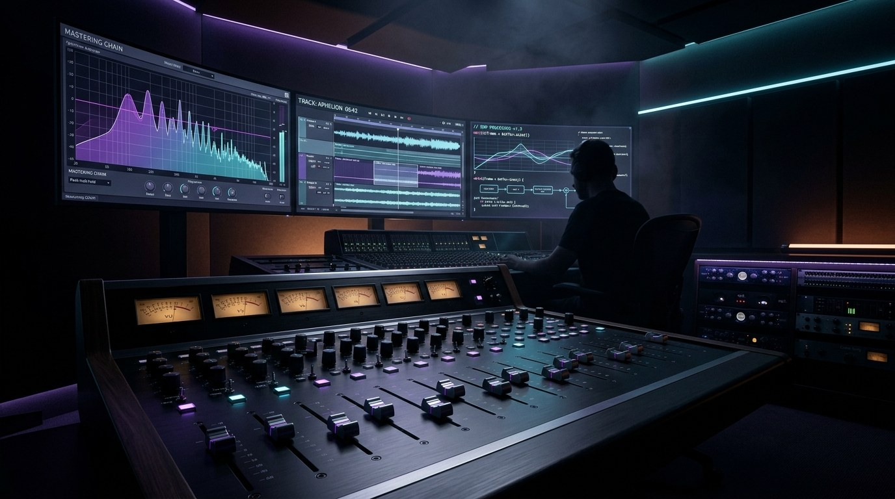

  

# Hi there, I'm Chang-Pao Chiu (Bao) 👋

  
  
  
  
  

### 🎧 Audio Engineering & DSP Developer | Building Autonomous AI Media Pipelines
I bridge the gap between classical acoustic engineering, spectral surgery, and modern software automation. Based in Taiwan, studying Applied Music (Audio Engineering) at TNNUA.

---

### 🔬 Core Specializations

- 🎛️ **Commercial Mixing & Mastering**: Broadcast-grade loudness engineering (-14 LUFS / True Peak control), phase coherence, dynamic EQ, and three-dimensional spatial imaging in **Pro Tools**.
- 🛠️ **AI Audio De-Artifact Restoration**: Developing specialized spectral repair workflows for AI-generated music (Suno / Udio), eliminating phase distortion, robotic comb filtering, and synthetic high-frequency harshness.
- ⚡ **Real-Time DSP & Plugin Development**: Designing low-latency VST3/AU audio plugins using **JUCE 8 (C++20)**, diatonic harmony engines, and **ONNX Runtime** neural inference.
- 🤖 **Media Automation & Pipelines**: Building autonomous multi-agent audio diagnostic scripts and batch stem processing utilities in Python.

---

### 🛠️ Tech Stack & Tooling

| Domain | Technologies & Workstations |
| :--- | :--- |
| **Audio Workstations (DAW)** | Pro Tools, SpectraLayers, iZotope RX, FabFilter Suite |
| **Languages & Frameworks** | C++20, JUCE 8, CMake, Python, PowerShell / Bash |
| **Audio DSP & Machine Learning** | Real-time Filtering, FFT / Spectral Analysis, ONNX Runtime C++ |
| **Media Automation** | FFmpeg, Soundfile, PyDub, Custom Agent Pipelines |

---

### 🌐 Featured Services & Connect

- 💼 **Professional Services**: [Hire on Fiverr (AI Audio Restoration & Mastering)](https://www.fiverr.com/chiubaooo)
- 👔 **LinkedIn**: [Chang-Pao Chiu](https://www.linkedin.com/in/chang-pao-chiu/)
- 📧 **Direct Contact**: `mrk30486479@gmail.com`

---

  

